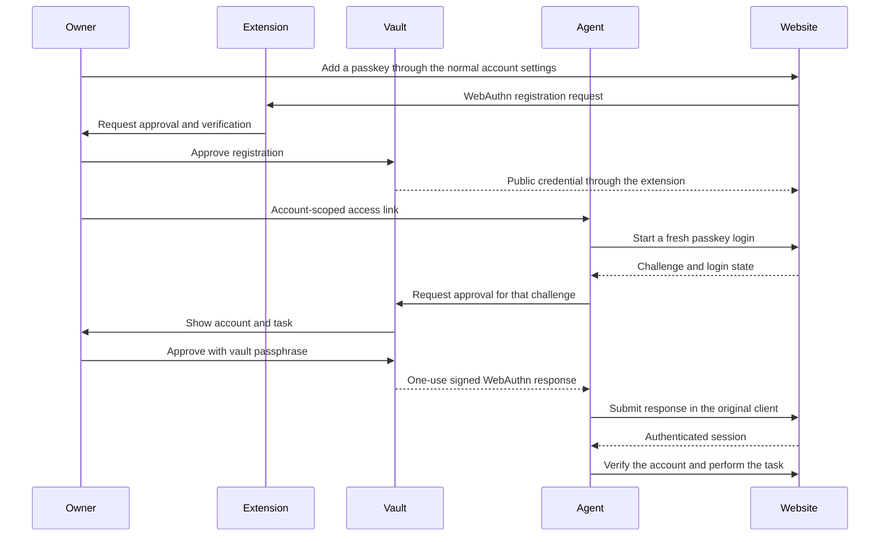
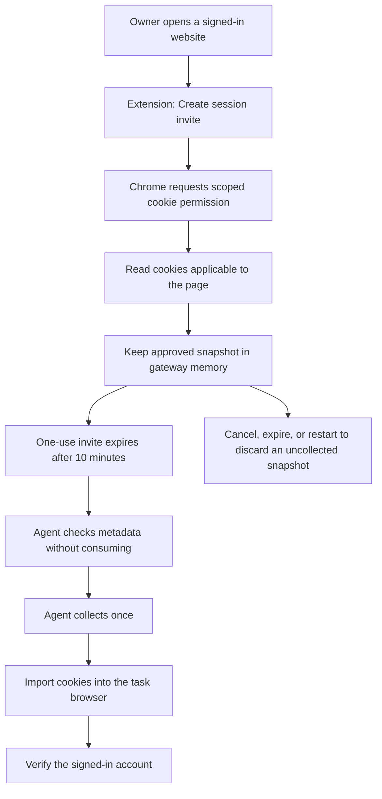

# Architecture

The owner runs the vault and dashboard locally. The Chrome extension supplies passkeys to websites and can separately capture an approved cookie session. A dedicated agent listener exposes the invitation and approval protocol through ngrok.

| Component | Default address | Role |
| --- | --- | --- |
| Owner dashboard and vault | `127.0.0.1:4780` | Enrollment, encrypted keys, approvals and revocation |
| Demo website | `localhost:4781` | Local registration and sign-in fixture |
| Agent listener | `127.0.0.1:4782` | Access-link metadata, challenge requests and collection |
| Chrome extension | Owner's browser | Native WebAuthn provider and scoped cookie capture |
| ngrok | Assigned public HTTPS origin | Tunnel to the agent listener only |
| Receiving agent | Its own browser or HTTP client | Website login, account verification and task execution |

## Passkey access

The private key remains in the vault. The gateway signs only the selected credential, configured origin and supplied challenge after fresh owner verification. Website challenge cookies and CSRF state remain in the agent's client. A browser task continues in the same browser context.

A persistent link permits new requests until revoked, with approval required each time. One-use invitations expire after one hour. Pending challenge requests expire after at most two minutes. A collected signature is bound to its website challenge and cannot be used for a different one.

## Cookie session sharing

This flow needs no enrolled passkey. Creation approves the capture and one collection. Attributes are preserved; the receiving browser must support importing them. The gateway stores the snapshot in memory and removes it on collection, expiry or cancellation. It never attaches to the owner's Chrome through a debugging connection for capture.

The website controls session validity. Cancelling the invite does not log out a recipient who already imported its cookies. Session sharing may fail when a website needs additional browser storage, partitioned state or device-bound credentials.

## API separation

| Token | Endpoints | Result |
| --- | --- | --- |
| Owner token | Local `/api/owner/*` and `/api/extension/*` | Vault management, approvals, enrollment and capture |
| Passkey link/invitation | `/api/agent/config`, `/api/agent/requests` | Account metadata and an approval request |
| Passkey request token | `/api/agent/request`, `/api/agent/redeem`, `/api/agent/cancel` | Status, one signed response, or cancellation |
| Cookie invitation | `/api/agent/session`, `/api/agent/session/redeem` | Non-secret metadata, then one cookie bundle |

Tokens are not interchangeable. ngrok exposes only the agent listener. The owner dashboard, private vault data and browser debugging endpoints remain local.
